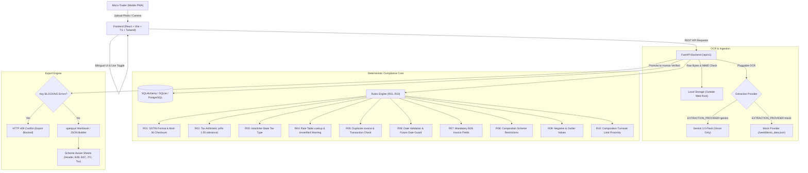

# KhataGST (खाताजीएसटी)

> **Assisted GST Compliance & Filing Preparation for Indian Micro-Traders**  
> Mobile-first Progressive Web App (PWA) with a 100% deterministic, bilingual statutory rules engine and zero LLM tax logic.

---

## 📌 Executive Summary & Non-Negotiable Principles

KhataGST is built for Indian micro-retailers, kirana owners, and small suppliers. It bridges the gap between messy paper vouchers and statutory compliance (GSTR-1, GSTR-3B, and CMP-08).

1. **Zero LLM Tax Calculation**: Multimodal AI (Gemini) is used **exclusively as a visual transcriber** to read handwriting, crumpled bills, and photos. It is strictly forbidden from computing taxes or guessing missing values.
2. **Deterministic Rules Engine (R01–R10)**: All statutory validation, tax arithmetic, place-of-supply checks, duplicate detection, and threshold warnings are executed by deterministic Python rules.
3. **Bilingual by Design**: Full English and Hindi translations for all UI screens, forms, tooltips, and rule explanations with a live one-click toggle.
4. **Export Safety (HTTP 409 Guardrail)**: Filing exports (.xlsx / .json) are blocked with an explicit HTTP 409 conflict whenever any statutory BLOCKING errors remain.
5. **Full Offline Readiness**: Out-of-the-box offline execution via seeded mock demo fixtures (`/seed/demo_data.json`).

---

## 🏛 Architecture & Tech Stack



---

## 🚀 Quickstart: Local Development

### 1. Backend Setup

```bash
# Navigate to backend directory
cd backend

# Create virtual environment
python -m venv venv
# Windows:
.\venv\Scripts\Activate.ps1
# Linux / macOS:
source venv/bin/activate

# Install dependencies
pip install -r requirements.txt

# Run migrations and seed rate tables
python -m alembic upgrade head
python -m app.seed_data

# Run API server
uvicorn app.main:app --reload --port 8000
```
Interactive API docs are available at: `http://localhost:8000/docs`.

### 2. Frontend Setup

```bash
# Navigate to frontend directory
cd frontend

# Install packages
npm install

# Start Vite development server
npm run dev
```
Open `http://localhost:5173` in your browser or mobile emulator.

---

## 🐳 Docker Compose Deployment

To run the entire multi-container production stack (PostgreSQL 16 + FastAPI + Nginx React PWA):

```bash
# 1. Copy environment template
cp .env.example .env

# 2. Build and run containers
docker compose up --build
```

- **Web Application**: `http://localhost:3000`
- **Backend API**: `http://localhost:8000`
- **PostgreSQL Database**: `localhost:5432`

---

## 📱 Offline Demo Walkthrough Script

You can experience the complete compliance workflow offline without requiring an internet connection or an active Gemini API key:

1. **Sign Up / Login**:
   - Open `http://localhost:3000` (or `http://localhost:5173`).
   - Switch to **Create Account**:
     - Email: `trader@example.com`
     - Password: `Password123!`
     - GSTIN: `07AAAAA0000A1Z5` (Delhi state `07`)
     - Scheme: `REGULAR`
     - Language: `en` (or `hi`)
2. **Upload Invoice**:
   - Select **Upload** in the bottom tab bar.
   - Choose `SALES` doc type and click **Select File** (pick any sample receipt or image).
   - Click **Upload & Extract Entries**.
   - With `EXTRACTION_PROVIDER=mock`, the app ingests the offline fixtures from `/seed/demo_data.json` and promotes them to the Review Table.
   - A persistent yellow **DEMO DATA** banner appears indicating test records are loaded.
3. **Review Table & Uncertain OCR Highlighting**:
   - Click **Review Table**.
   - Notice the amber highlighting on fields with OCR confidence `< 85%` with the `⚠️` icon and tooltip, prompting the shopkeeper to verify digits.
   - Click on the **Languages** button in the header or drawer to see all UI text and validation findings switch live to **हिंदी**.
4. **Trigger Statutory Error & 409 Blocking**:
   - In the table, edit the invoice GSTIN to an invalid checksum (e.g. `07AAAAA0000A1Z9`) and click **Save**.
   - Click **Re-Validate**: the row status turns into a red **BLOCKING** badge.
   - Click the red badge to inspect the explanation drawer.
   - Navigate to the **Summary & Export** tab: notice that the Excel and JSON download buttons are **disabled** with an alert: *"Filing Export Blocked (HTTP 409 Constraint)"*.
5. **Resolve Error & Export**:
   - Return to the Review Table, correct the GSTIN to `07AAAAA0000A1Z4` (or `27AABCG1234F1Z8`), and save.
   - Click **Re-Validate**: badge switches to green **Compliant**.
   - Return to **Summary & Export**: export buttons are enabled!
   - Download the generated `.xlsx` file. Inspect the sheets: `Header` with `"DRAFT: review before filing"`, `B2B`, `B2C Summary`, `Purchases`, and `Tax Summary`.

---

## 🔒 Privacy & Image Retention Treatment

- **Storage Location**: Uploaded source images are stored outside the web root (`./storage`) with random hex UUID filenames, preventing path traversal and unauthorized public direct access.
- **Access Authorization**: Every document and reviewed entry checks `document.user_id == current_user.id`. Cross-user data reading is strictly blocked.
- **Source Image Deletion Option**:
  - In compliance with Indian micro-business privacy concerns, users can check:  
    `[x] Delete raw source invoice images after successful export`
  - When enabled, the backend permanently deletes the source image file from disk and updates the audit log once the spreadsheet has been downloaded.
- **GSTIN Masking**: Full GSTINs are never logged in plain text in production logs; they are masked to first 2 and last 3 characters (`07**********1Z5`).

---

## 📐 Assumptions & Statutory Grounding

The following explicit design decisions and statutory assumptions are grounded in official CBIC / GSTN documentation:

| Component | Assumption / Statutory Baseline | Official Reference |
| :--- | :--- | :--- |
| **GSTIN Validation (R01)** | Uses standard 15-character format `[0-9]{2}[A-Z]{5}[0-9]{4}[A-Z]{1}[1-9A-Z]{1}Z[0-9A-Z]{1}` and Mod-36 Luhn-like checksum. | GST Act Section 22-25 / GSTN Schema |
| **Tax Rounding Tolerance (R02)** | A tolerance of **±₹1.00** is permitted on tax arithmetic calculations to accommodate fractional rounding on paper invoices. | Section 170 of the CGST Act |
| **Place of Supply (R03)** | If counterparty state matches user business state -> intra-state supply (**CGST + SGST**). If state codes differ -> inter-state supply (**IGST**). | IGST Act Section 7 & 8 |
| **Rate Table Verification (R04)** | Rates in `seed/rate_table_seed.json` are seeded with `verified=false` to reflect draft status until confirmed against official notifications. | CBIC Rate Schedule (Notification No. 01/2017-CT) |
| **Duplicate Prevention (R05)** | Duplicate checks match on `(party_gstin, invoice_no)` or `(party_name, date, total)`. | GSTN Duplicate Invoice Ingestion Rules |
| **Date Boundaries (R06)** | Invoices cannot be dated in the future and must fall within the selected return filing period (`YYYY-MM`). | CGST Rules 2017 |
| **Composition Restrictions (R08)** | Composition dealers cannot charge separate taxes to customers and cannot make inter-state outward supplies. | Section 10 of CGST Act |
| **Composition Limits (R10)** | Presumptive annual turnover limit set to **₹1.5 Crore** for goods traders and **₹50 Lakhs** for service providers. Warns at 85% proximity. | Notification No. 14/2019-CT |
| **Vision Model Downscaling** | Large camera photos (>3000px) are automatically resized in memory to `max_dimension=2048` with Pillow before calling Gemini to prevent payload timeouts. | Google Gemini API Vision Best Practices |

---

## 🧪 Testing & Verification

### Running All Test Suites

```bash
# 1. Run Backend Pytest Suite (74 tests including unit & E2E)
$env:PYTHONPATH="backend"; python -m pytest backend/tests/ -v

# 2. Run Frontend Vitest Component Suite (19 tests)
cd frontend
npm test

# 3. Verify Frontend Production Build
npm run build

# 4. Run Real Dev Invoice Extraction Evaluation
python eval/eval_extraction.py --split dev
```

---

## 📄 License & Compliance Notice

This software is designed as an assisted compliance tool for Indian micro-traders. All generated spreadsheets and JSON files are marked with **"DRAFT: review before filing"** and must be reviewed against physical vouchers and verified with official CBIC / GSTN portal notifications before submission.

